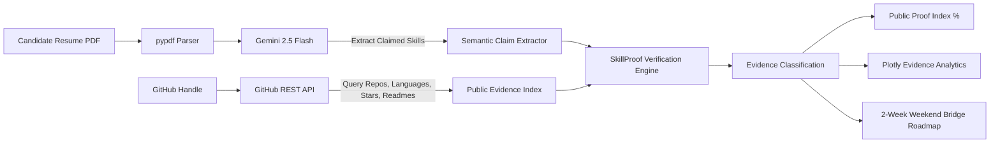

# SkillProof AI — Evidence-Based Career Readiness Engine

[](https://streamlit.io)
[](https://www.python.org/downloads/)
[](https://deepmind.google/technologies/gemini/)

> **SkillProof AI** bridges the gap between resume claims and demonstrable open-source proof. It parses candidate resumes, queries public GitHub engineering activity, performs semantic skill verification with Google Gemini, and delivers an actionable 2-week bridge plan to close public evidence gaps.

---

## 📌 Problem Statement

In contemporary technical hiring and internship evaluations:
1. **Resume Inflation & Keyword Stuffing**: Resumes frequently list dozens of buzzwords (e.g., *Distributed Systems, PyTorch, Kubernetes, GraphQL*) without tangible verification of hands-on proficiency.
2. **Reviewer Fatigue**: Recruiters and engineering hiring managers spend under 30 seconds scanning each CV and lack the time to manually audit every applicant's GitHub profile, repos, and commit histories.
3. **The Proof Gap for Students & Early-Career Devs**: Qualified engineers often possess core skills but lack structured guidance on *how to make their skills verifiable* in public open-source portfolios.

---

## 💡 The Solution Workflow



1. **PDF Resume Parsing**: Extracts structured text across skills, projects, and work experience using `pypdf`.
2. **Claim Identification**: Uses `gemini-2.5-flash` with structured JSON output to extract technical skills (languages, frameworks, developer tools, database engines, platforms).
3. **GitHub Footprint Ingestion**: Fetches public repositories, primary languages, descriptions, topics, star counts, and recent commits via the GitHub REST API.
4. **Evidence-Based Triangulation**: Evaluates each claimed skill against public repositories, matching languages, library usages, and architectural depth:
   - 🟢 **Strong Public Evidence**: Clear, multi-repo or starred implementation evidence with active code artifacts.
   - 🟡 **Weak Public Evidence**: Incidental mentions, forks, empty templates, or minimal single-file exposure.
   - 🔴 **No Public Evidence**: Zero discoverable traces in public GitHub repositories.
5. **Public Proof Index (PPI)**: Quantitative composite score (0–100%) reflecting verifiable readiness.
6. **2-Week Weekend Bridge Plan**: Generates targeted mini-projects, repository blueprints, and testing milestones to turn unverified skills into verifiable public repositories.

---

## ⚖️ Ethical Disclaimer

> **SkillProof AI indexes public GitHub repositories. Private work and offline projects are excluded; unindexed skills reflect a public evidence gap, not a lack of student ability.**
>
> *SkillProof AI does not assess NDA-protected commercial code, private repositories, classroom submissions stored offline, or proprietary enterprise systems. The resulting Public Proof Index measures public portfolio visibility rather than intrinsic engineering merit.*

---

## 🛠️ Tech Stack

- **Frontend & Interface**: [Streamlit](https://streamlit.io/) (Data apps, metric widgets, custom layout, reactive styling)
- **Large Language Model**: [Google Gemini 2.5 Flash](https://ai.google.dev/) via the official `google-genai` SDK
- **Data Visualization**: [Plotly](https://plotly.com/) (Interactive horizontal bar chart & evidence distribution breakdown)
- **Data Engineering**: [Pandas](https://pandas.pydata.org/) (Data frames, aggregation, categorization)
- **Document Ingestion**: [pypdf](https://pypdf.readthedocs.io/) (High-performance text extraction)
- **API Integration**: [GitHub REST API v3](https://docs.github.com/en/rest) with personal access token support

---

## 🚀 Quickstart Guide

### Prerequisites
- Python 3.10 or higher
- A [Google Gemini API Key](https://aistudio.google.com/)
- (Optional) A [GitHub Personal Access Token](https://github.com/settings/tokens) (avoids GitHub API 60 req/hr rate limits)

### 1. Clone & Navigate
```bash
git clone https://github.com/your-username/skillproof-ai.git
cd skillproof-ai
```

### 2. Set Up Virtual Environment
```bash
# On macOS/Linux
python3 -m venv .venv
source .venv/bin/activate

# On Windows
python -m venv .venv
.venv\Scripts\activate
```

### 3. Install Dependencies
```bash
pip install -r requirements.txt
```

### 4. Configure Environment Variables (Optional)
You can create a `.env` file in the root directory:
```env
GEMINI_API_KEY=your_gemini_api_key_here
GITHUB_TOKEN=your_optional_github_token_here
```
*(You can also enter your keys directly in the Streamlit app sidebar).*

### 5. Launch the Application
```bash
streamlit run app.py
```

The app will open automatically at `http://localhost:8501`.

---

## 📂 Project Structure

```text
skillproof-ai/
├── app.py              # Main Streamlit web application & analysis pipeline
├── requirements.txt    # Python dependencies
├── .gitignore          # Ignored local files, keys, and environments
├── .env.example        # Sample environment variable template
└── README.md           # Documentation and architecture guide
```

---

## 📊 Verification Criteria

| Category | Criteria |
| :--- | :--- |
| **🟢 Strong Public Evidence** | Dedicated repositories, primary code languages matching the skill, rich commit history, or stars/forks indicating real utility. |
| **🟡 Weak Public Evidence** | Single brief commit, toy starter repository, fork without substantive original code, or superficial configuration. |
| **🔴 No Public Evidence** | Claimed in resume but absent from public repositories, commit histories, and repository metadata. |

---

## 📄 License
This project is licensed under the Apache 2.0 License - see the LICENSE file for details.
